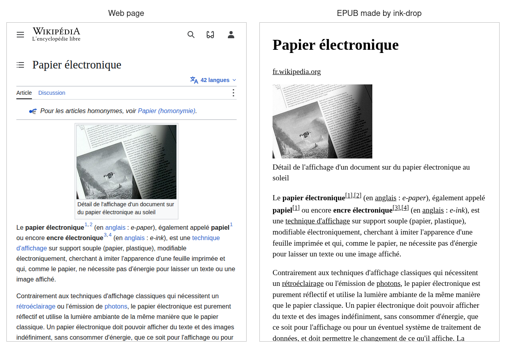

# ink-drop

Web pages, feeds and your own Markdown, made into books that any e-reader reads
offline.

Everything lands in one folder of EPUB books, and reading needs no network. The
tablet app is in the [latest release](https://github.com/offware-apps/ink-drop/releases/latest).

| Part | What it does |
| --- | --- |
| [Tablet app](#on-the-tablet) | Fetches your feeds every few hours and saves pages you share to it. Files each article as a book per feed and section, with its date and author. Keeps what you star or set aside, and asks before every delete. |
| [Stages](#on-the-laptop) | `ink-fetch`, `ink-readable`, `ink-feed` and `ink-epub`: small commands that chain in a shell pipe, the same ones the app runs. |
| [Browser extension](#the-browser-extension) | Saves the page you are reading as an EPUB, and with its helper lists your library and sends a book to the reader. |
| [Sync folder](#the-sync-folder) | Your sync tool, Syncthing for one, carries books from the laptop into the tablet's `Laptop` folder. |



*Left, the French Wikipedia article on
[electronic paper](https://fr.wikipedia.org/wiki/Papier_%C3%A9lectronique) as
the web serves it; right, the EPUB the stages made from it. Text
[CC BY-SA 4.0](https://creativecommons.org/licenses/by-sa/4.0/), photo
[public domain](https://commons.wikimedia.org/wiki/File:E-ink-display-detail.jpg).*

## TL;DR

```sh
# 1. Build and sign the tablet app, then install it, or take ink-drop.apk from the latest release
android/build.sh && adb install -r android/build/ink-drop.apk
# 2. Build every laptop stage
go build -o bin/ ./cmd/...
# 3. Turn one article into an EPUB in the library
echo https://example.org/post | bin/ink-fetch | bin/ink-readable | bin/ink-epub -to ~/Books
# 4. Turn the new posts of one site's feed into an EPUB
echo https://go.dev/blog/ | bin/ink-feed | bin/ink-epub -to ~/Books
# 5. Install the extension's helper, then load extension/ in Firefox
go install github.com/offware-apps/ink-drop/cmd/ink-send@latest
ink-send -install
```

## On the tablet

The [Android app](android/) runs the stages on the tablet itself, so news
arrives without the laptop. Download `ink-drop.apk` from the
[latest release](https://github.com/offware-apps/ink-drop/releases/latest) for a
tablet on Android 13 or later with a 64-bit ARM chip, or build it with
`android/build.sh`. The Books tab first asks for the folder the books
go to, `Books/ink-drop` for one; the tablet's library reads them from there. It
refuses the laptop's `Laptop` folder, and keeps access to the one folder picked.

Every list turns by the page, as the tablet's reader does, rather than
scrolling: Previous and Next under the list, a swipe left or right anywhere, or
the page and volume keys. The screens are black and white with no animation, so
the e-ink screen leaves no ghosts.

### Books

- A Refresh button fetches every feed now, and says what came of it: how many
  books were saved, and how many addresses failed.
- A chip per folder, newest first, after All, `Pages` and `Laptop`: the feeds
  shown two rows deep, the rest a tap away on the Feeds tab. Under a feed's
  chip, a chip per section with its count, `Politique 12`, the fullest first.
- A Today chip keeps the list to the last 24 hours, and an Unread chip to the
  books never opened from the app. An unread title is bold; a book opened shows
  a ✓ and a regular grey title.
  The ≡ at the right of that line packs each book onto one line at the same type size: the mark and initials,
  the title, then the feed, date and author; ☰ spreads them again.
- Each book shows a mark for its section, 🏛 for politics or 🔬 for science,
  and its feed's initials in a box; the feed, the section, when the article was
  published and its author above its title. The list runs newest first by that
  date, and a book whose feed gives none takes the time it arrived. A NEW tag marks each book that arrived since you
  last left the app and has not been opened from it.
- Later sets a book aside in `Read later` and ☆ moves it to `Favourites`: two
  folders of their own, which no feed's settings reach. Done, or ★ on a
  favourite, puts the book back in the folder it came from, else in its feed's
  folder by its address, or in `Pages`.
- A tap opens the book in the tablet's reader, and ✕ deletes it after asking,
  except in `Laptop`, whose books the laptop's sync owns. A long press on a
  folder's chip deletes the folder's books after asking, `Laptop` and `Pages`
  aside.

To save a page, share it to ink-drop from the browser: it becomes a book in
`Pages`, its article alone, its pictures inside it. A share made while a
refresh runs waits for it and says so. The same page shared again replaces its
book with the page as it is now.

### Feeds

- Add a feed by its address, or a site's, whose feed ink-drop finds in its
  page; or search 841 feeds of the [awesome-rss-feeds](android/assets/directory/SOURCE)
  list by topic, country or name, searched on the tablet with no network.
- Import and Export the list as one OPML file, the format every feed reader
  reads, so a list moves from another reader and back.
- Each feed's row shows its site and what it keeps. Remove takes it off the
  list, and offers to delete its books too, unless another feed shares its
  folder.

Tap a feed to open its settings, each saved as it is picked:

| Setting | Choices | Default |
| --- | --- | --- |
| Keep each book | 1 day, 3 days, 1 week, 1 month, for ever | for ever |
| Keep at most | no limit, 20, 50 or 100 books | no limit |
| New articles arrive as | separate books, or one book together, which holds a refresh's articles with a contents list | separate books |
| Leave out articles holding | words, comma-separated | none |
| Keep only articles holding | words, comma-separated | every article |

After each refresh, the books past what the feed keeps are deleted from its
folder. A word matches a whole word of the title or the summary the feed gives,
whatever its case and accents, and an article left out never comes back. The
settings travel in the exported OPML file, in attributes other readers skip.
Open its books shows that feed's folder on the Books tab.

### Settings

- Refresh on its own: off, or every 1, 3, 6 or 12 hours, 3 by default, and
  only while the tablet is online. The line under it says when the last
  refresh ran and what it saved.
- Screen: Grey for an e-ink screen, the marks drawn darker in grey and new
  books' pictures in grey, the lightest; or Colour for a colour tablet, both as
  they are. Either way no picture is wider than the screen, and a picture its
  copy would make heavier stays as it came.
- The books folder, and Change to pick another.

### Logs

The Logs tab shows what ink-drop did, newest first: each refresh and share
with its outcome as a heading, every stage's exit and the errors it printed,
each book copied with its size, and how many books a feed's settings deleted.
Clear empties it.

### What a refresh does

For each feed, starting after the one the last refresh reached, so a refresh
cut short reaches every feed in turn:

1. `ink-feed` fetches the feed and keeps the entries it has not seen, at most
   50 a run, leaving out those the feed's words leave out. An entry the feed
   gives as a summary alone is fetched from its page, so the book holds the
   whole article; a busy server's article is tried again in the next runs.
2. `ink-epub` makes each a book, its pictures fitted to the screen.
3. The app copies each book into the feed's folder, in a section's folder
   where the article's address names one: `Le Monde.fr/Politique`. An
   article already there is not copied twice.
4. The books past what the feed keeps are deleted.

A page leaves the app's own storage only once its book is in your folder, so a
refresh stopped part way, the network gone or the folder no longer there,
loses nothing: the next one picks it up.

### What the app may do

`android/build.sh` builds and signs the app with the Android SDK's own tools and
no Gradle, from a key kept in `~/.config/ink-drop/`. The app asks for three
permissions: network access, the network's state to find its DNS servers, and a
start at boot to keep its refresh scheduled. Of the tablet's storage it reads
and writes the folder you picked, and a feed list you pick to import or export.
Any app can share an address with it, so every download it starts is refused an
address on the tablet itself or on the network it sits on. Where the tablet sets
a Private DNS host, every lookup goes over TLS to that host.

## On the laptop

Each stage reads one line at a time on stdin, a URL for `ink-fetch` and
`ink-feed` and an item path for the others, and prints the paths it wrote. Each
hands its result to the next through a plain folder, whose shape is
[the folder contract](docs/folder.md). `-to` sets the folder a stage writes to:
`ink-fetch`, `ink-feed` and `ink-readable` default to `ink-drop/<stage>` under
the user cache folder, and `ink-epub` needs it.

| Command | Job | State |
| --- | --- | --- |
| [`ink-fetch`](cmd/ink-fetch/main.go) | Downloads each URL into the work folder | Built |
| [`ink-readable`](cmd/ink-readable/main.go) | Strips each HTML item down to its article | Built |
| [`ink-epub`](cmd/ink-epub/main.go) | Packs each HTML item into an EPUB in the library | Built |
| [`ink-feed`](cmd/ink-feed/main.go) | Turns the new entries of each RSS or Atom feed into one digest item | Built |
| [`ink-send`](cmd/ink-send/main.go) | Lists the library for the browser extension and copies a ticked book to the sync folder | Built |
| [`ink-mirror`](cmd/ink-mirror/main.go) | Crawls one site into a single HTML item | Not built |

`ink-send` reads no stdin line: Firefox starts it for each request the
extension makes.

`ink-feed` takes a feed's address or a site's: given a page, it follows the
first feed the page names in a link tag. An entry the feed gives as a summary
alone is fetched from its page, so the book holds the whole article. One digest
per feed is the default, `-each` writes one item per article instead, and
`-mute` and `-only` take the words a feed's settings take on the tablet. Nothing
fetches feeds on its own on the laptop: [docs/schedule.md](docs/schedule.md)
sets up an hourly run that you enable.

A PDF needs no conversion: `ink-readable` passes it through and `ink-epub`
copies it into the library. `ink-fetch` inlines a page's images, so every later
stage runs offline. `ink-epub -max-width` and `-grey` fit the pictures as the
tablet does.

### The browser extension

The [extension](extension/) saves the page you are reading as an EPUB through the
browser's downloads, with nothing else installed. To load it, open
`about:debugging#/runtime/this-firefox` in Firefox, click *Load Temporary
Add-on* and pick `extension/manifest.json`. Firefox keeps a
[temporary add-on](https://extension-workshop.com/documentation/develop/temporary-installation-in-firefox/)
until it restarts.

Its library page lists every book in one place, with a tab per folder, a search,
a sort, a box to tick for each book you want on your reader and a bin to delete
one. Without its helper it lists only the pages the extension saved. The helper
is [`ink-send`](cmd/ink-send/main.go), a small program Firefox starts for each
request: it lists the whole library, sends a ticked book and backs the *Send*
button the popup shows after a save. `ink-send -install` registers it for your
user and writes its settings to `~/.config/ink-drop/folders.json`:

```json
{
  "library": "~/Downloads/ink-drop",
  "sync": "~/Sync/reader",
  "routes": [
    {"path": "~/notes/idea.md"},
    {"path": "~/notes/recipes", "tab": "food"},
    {"path": "~/notes/guide", "title": "My guide", "files": ["intro.md", "setup.md"]},
    {"path": "~/work/reviews", "tab": "reviews", "book": "overview.md", "rounds": "^(\\d+)-"}
  ]
}
```

`library` is the folder the browser saves pages into, `ink-drop` under your
download folder, so nothing ever moves a file into it. A different folder set on
the library page needs `library` set to match.

### The sync folder

`sync` is the one folder your sync tool sends to the reader. Ticking a book, or
*Send* in the popup, copies it there, and unticking removes it. ink-drop never
sends anything itself: the sync tool does, when you let it run. With the tablet
app, point `sync` at the `Laptop` folder inside the app's folder, and share only
`Laptop` with the tablet, so the sync tool and the app never write the same
files.

### Routes

A route offers Markdown already on this machine as books, made only when you tick
one:

- a file is one book;
- a folder offers each of its Markdown files, up to 16 folders deep, as its own
  book;
- `files` makes one book of the Markdown files listed, each inside `path`, in
  that order;
- `book` makes each folder holding a file of that name one book, of the Markdown
  beside it and in the highest numbered folder `rounds` matches, its first
  group read as the number.

`tab` names the library folder and the page's tab, `notes` when left out. A route
is read and never written, and unticking a book deletes the copy that was made. A
file or folder the helper cannot read is left out of the list, and so is a book
over [1 MiB of Markdown](cmd/ink-send/routes.go#L57). A book that takes more
than [20 seconds or 512 MB](cmd/ink-send/routes.go#L447-L448) to make is
refused.

### What the helper cannot do

`ink-send` holds no code that starts a program or opens a connection, and [a
test](cmd/ink-send/main_test.go) fails if the standard library's code for either
ever enters it. Every file it reads or writes, in the library, the sync folder
and the routes, goes through a root that no name or link can leave, and it
opens only plain files. The browser names a library book by its name in the
library, at most one folder deep, or a route book by an id from the helper's own
walk, never a path, and a route holding the home folder or the whole disk is
refused.

## Rules

ink-drop is a tool block under article VIII of the
[Offware constitution](https://github.com/offware-apps/Vision/blob/main/constitution.md):
it runs outside any app and feeds one through plain files.
[constitution.md](constitution.md) checks it against every article.

## License

[MIT](LICENSE).
