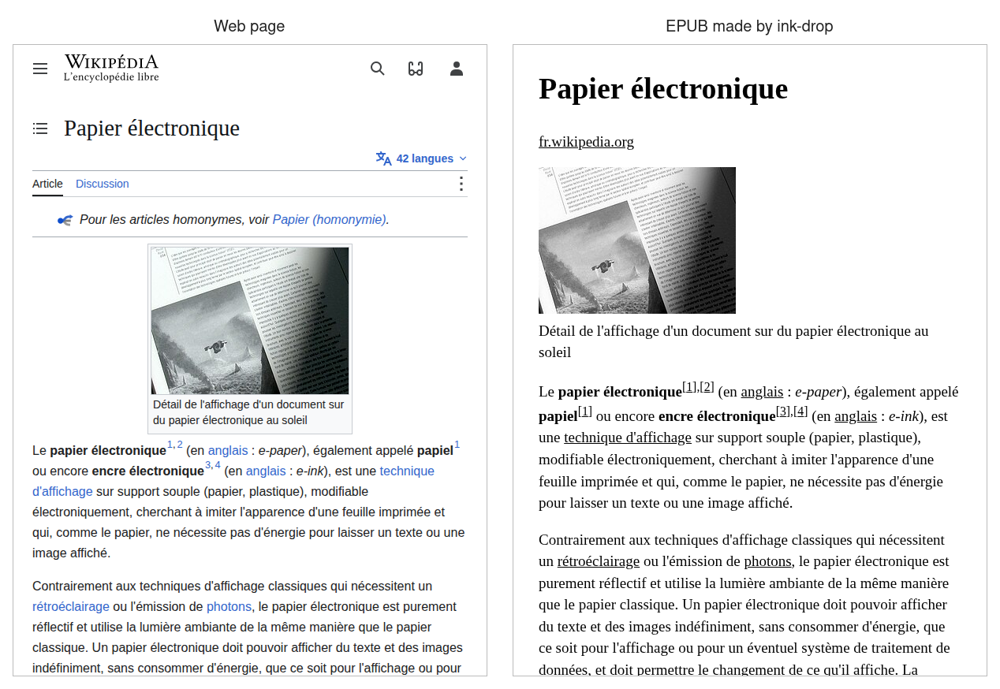

# ink-drop

Web pages, PDFs and feeds, fetched into one folder that any e-reader reads
offline.

ink-drop is a set of small command-line stages. Each one does a single job and
hands its result to the next through a plain folder, whose shape is
[the folder contract](docs/folder.md). The finished folder is the library:
sync it to a Boox, a Kobo or any tablet with whatever already syncs there,
Syncthing, WebDAV or a USB cable. Reading needs no network.

> The French Wikipedia article on
> [electronic paper](https://fr.wikipedia.org/wiki/Papier_%C3%A9lectronique),
> on the left as the web serves it and on the right as the EPUB the three
> stages made from it. Both are headless Chromium at 600×800, the EPUB page in
> greyscale with a serif stylesheet standing in for an e-ink reader's. Text
> [CC BY-SA 4.0](https://creativecommons.org/licenses/by-sa/4.0/), photo
> [in the public domain](https://commons.wikimedia.org/wiki/File:E-ink-display-detail.jpg).



Each stage reads one line at a time on stdin, a URL for `ink-fetch` and an
item path for the others, and prints the paths it wrote. `-to` sets the
folder it writes to: `ink-fetch` and `ink-readable` default to
`ink-drop/<stage>` under the user cache folder, and `ink-epub` needs it.

## TL;DR

```sh
# 1. Build every stage
go build -o bin/ ./cmd/...
# 2. Turn one article into an EPUB in the library
echo https://example.org/post | bin/ink-fetch | bin/ink-readable | bin/ink-epub -to ~/Books
```

## Stages

| Stage | Job | State |
| --- | --- | --- |
| [`ink-fetch`](cmd/ink-fetch/main.go) | Downloads each URL into the work folder | Built |
| [`ink-readable`](cmd/ink-readable/main.go) | Strips each HTML item down to its article | Built |
| [`ink-epub`](cmd/ink-epub/main.go) | Packs each HTML item into an EPUB in the library | Built |
| [`ink-feed`](cmd/ink-feed/main.go) | Turns each RSS or Atom feed into one digest item | Not built |
| [`ink-mirror`](cmd/ink-mirror/main.go) | Crawls one site into a single HTML item | Not built |

A PDF needs no conversion: `ink-readable` passes it through and `ink-epub`
copies it into the library. `ink-fetch` inlines a page's images, so every
later stage runs offline.

## Rules

ink-drop is a tool block under article I of the
[Offware constitution](https://github.com/offware-apps/Vision/blob/main/constitution.md):
it runs outside any app and feeds one through plain files.
[constitution.md](constitution.md) checks it against every article.

## License

[AGPL-3.0](LICENSE).
